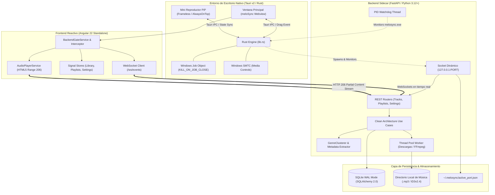

# meloSync 🎵
**Next-Generation Personal Music Manager, High-Fidelity YouTube Downloader & Local Streaming Desktop Engine**

[](https://tauri.app/)
[](https://angular.dev/)
[](https://fastapi.tiangolo.com/)
[](https://www.python.org/)
[](https://www.rust-lang.org/)
[](https://www.sqlite.org/)
[](#testing--quality-assurance)
[](#testing--quality-assurance)
[](#)

---

## 📖 Descripción General

**meloSync** es un ecosistema de escritorio híbrido de alto rendimiento para la descarga inteligente, normalización acústica, catalogación automática y reproducción local de música en streaming. 

Diseñado bajo los estándares de **Clean Architecture**, **Domain-Driven Design (DDD)** y los principios **SOLID**, desacopla por completo un sidecar de backend asíncrono en **FastAPI**, una interfaz reactiva en **Angular 22** construida exclusivamente con *Signals*, y un contenedor nativo multiplataforma en **Tauri v2 (Rust)** con soporte multi-ventana, control nativo de Windows (SMTC) y un mini reproductor Picture-in-Picture (PiP).

Su experiencia visual adopta un diseño minimalista y sobrio inspirado en el modo oscuro de **Apple Music**, enfocado en la pureza tipográfica, superficies translúcidas en escala de grises y zinc, y cero distracciones visuales.

---

## 🌟 Pilares y Capacidades Técnicas

### 1. Arquitectura de Escritorio Multi-Ventana (Tauri v2 + Rust)
- **Mini Reproductor Picture-in-Picture (PiP)**: Ventana flotante secundaria (`label: "mini-player"`), independiente, `alwaysOnTop` y translúcida.
  - Modo dinámico responsivo: conmuta fluidamente entre modo compacto (*Píldora* $<140\text{px}$) y carátula centrada 1:1 estricta sin distorsión.
  - Arrastre nativo mediante Windows API (`WM_NCLBUTTONDOWN`) gestionado por el comando Rust `start_dragging_window`.
  - Sincronización bidireccional en tiempo real entre la ventana principal y el mini reproductor mediante eventos de Tauri e IPC.
- **Integración con Windows SMTC**: Enlace directo con *System Media Transport Controls* (`windows_identity.rs`), permitiendo el control de reproducción, pista siguiente/anterior y volumen desde teclas multimedia físicas, superposiciones flyout y la pantalla de bloqueo de Windows.

### 2. Compuerta Reactiva de Cero Latencia y Puerto Efímero
- **Prevención de Colisiones de Puerto (`WSAEADDRINUSE`)**: Tauri asigna dinámicamente un puerto efímero libre (`127.0.0.1:0`) mediante `TcpListener::bind` y lo transfiere como argumento `--port` al backend.
- **`BackendGateService` & `BackendReadyInterceptor`**: 
  - La interfaz de Angular se renderiza instantáneamente ($0\text{ ms}$) en frío sin esperar al backend.
  - Las peticiones HTTP entrantes durante la inicialización se encolan reactivamente sin emitir errores de red o toasts prematuros.
  - Al recibir el evento `backend-ready`, las solicitudes retenidas se reescriben al puerto dinámico y se despachan de forma concurrente.
- **Descubrimiento y Persistencia**: Escritura atómica del puerto activo y PID en `~/.melosync/active_port.json` para herramientas externas y sesiones de desarrollo web en navegador.

### 3. Ciclo de Vida y Terminación Garantizada de Procesos
- **Windows Job Objects (`KILL_ON_JOB_CLOSE`)**: El kernel de Windows asegura que ante cualquier terminación de `melosync.exe` (cierre de ventana, Ctrl+C o cierre forzoso), todo el árbol de procesos del backend Python muera síncronamente sin dejar procesos huérfanos.
- **Manejador de Consola `SetConsoleCtrlHandler`**: Intercepta `CTRL_C_EVENT` y `CTRL_CLOSE_EVENT` para cerrar sockets y recursos de forma limpia.
- **Watchdog de Proceso Padre**: Hilo demonio en Python que comprueba el estado del PID padre mediante `WaitForSingleObject` cada $500\text{ ms}$, forzando la autoterminación inmediata si el proceso de interfaz desaparece.

### 4. Motor Inteligente de Metadatos y Clustering de Géneros
- **Clustering Fonético y por Proximidad (`GenreClusterer`)**:
  - Resuelve la fragmentación de géneros (p. ej. `K-Pop`, `K-pop`, `k-pop`, `KPop`, `K Pop` se unifican en un único cluster canónico `K-Pop`).
  - Extracción multi-género: divide cadenas compuestas (`,`, `;`, `/`, `|`, `&`) preservando guiones y acrónimos (`"K-Pop, Dance"` asocia la canción a ambas listas).
  - Diccionario canónico de géneros (`kpop` $\rightarrow$ `K-Pop`, `hiphop` $\rightarrow$ `Hip-Hop`, `rnb`/`rb` $\rightarrow$ `R&B`, `soundtrack`/`ost` $\rightarrow$ `Soundtrack`, `lofi` $\rightarrow$ `Lo-Fi`, etc.).
  - Coincidencia difusa (*fuzzy string matching*) con `SequenceMatcher` ($\ge 0.88$ de similitud) y normalización de plurales.
- **Desduplicación y Purga en Base de Datos**:
  - Fusiona listas de género duplicadas preexistentes en una única lista principal con todas las canciones combinadas.
  - Purga automática de listas obsoletas o con menos de 2 canciones.
- **Separación de Colaboraciones en Artistas**:
  - Descompone colaboraciones multi-artista (`feat.`, `&`, `with`, `vs.`) para que cada artista cuente con su propio mix individual consolidado.
  - Descarga y almacenamiento en caché de biografías oficiales y fotografías de alta resolución vía iTunes Search API.

### 5. Pipeline Acústico de Descarga y Procesamiento
- **Pipeline por Etapas en Tiempo Real**: Notificación continua mediante WebSockets (`/ws/events`) a través de la máquina de estados:
  $$\text{PENDIENTE} \longrightarrow \text{DESCARGANDO} \longrightarrow \text{PROCESANDO\_AUDIO} \longrightarrow \text{OBTENIENDO\_METADATOS} \longrightarrow \text{COMPLETADA}$$
- **Normalización Acústica Profesional**: Procesamiento mediante `FFmpeg` aplicando el estándar **EBU R128** (`loudnorm`) a un nivel objetivo de $-14\text{ LUFS}$ y recorte de silencios iniciales/finales.
- **Etiquetado ID3 Completo**: Inyección de carátulas en alta resolución ($1000\times1000$) y metadatos limpios mediante `mutagen`.

### 6. Sistema de Diseño Minimalista y Accesible (Apple Music Dark)
- Estética oscura monocromática con contraste tipográfico nítido y acento de marca `#fa2d48`.
- Eliminación total de ruidos visuales, fotos redundantes en vistas de artista y etiquetas decorativas innecesarias.
- Cumplimiento de accesibilidad **WCAG AA** y validación completa de cheques **AXE**.
- Controles de scroll nativos y suaves con `scrollbar-gutter: stable`.

---

## 🏗️ Diagrama de Arquitectura del Sistema



---

## 📂 Estructura del Proyecto

```
meloSync/
├── backend/                              # Backend FastAPI + Clean Architecture
│   ├── src/
│   │   ├── domain/                       # Entidades puras, Enums, Interfaces y Excepciones
│   │   │   ├── entities.py               # Track, TrackMetadata, Playlist, AppSettings
│   │   │   ├── exceptions.py             # Excepciones de dominio
│   │   │   └── repositories.py           # Interfaces abstractas de repositorios y UoW
│   │   ├── application/                  # Casos de uso, DTOs y lógica de negocio
│   │   │   ├── dto.py                    # Data Transfer Objects fuertemente tipados
│   │   │   ├── services/                 # Servicios de aplicación
│   │   │   │   ├── genre_clustering.py   # Motor de clustering inteligente de géneros
│   │   │   │   └── path_resolver.py      # Resolución dinámica de rutas y carpetas
│   │   │   └── use_cases/                # Casos de uso
│   │   │       ├── manage_playlists.py   # Sincronización inteligente y CRUD de playlists
│   │   │       ├── sync_library.py       # Indexación de música local
│   │   │       ├── search_youtube.py     # Búsqueda en YouTube vía yt-dlp
│   │   │       ├── download_track.py     # Pipeline de descarga y normalización
│   │   │       └── edit_metadata.py      # Edición de tags ID3 en disco
│   │   ├── infrastructure/               # Adaptadores externos y tecnologías
│   │   │   ├── audio/                    # Mutagen tagger y FFmpeg normalizer (EBU R128)
│   │   │   ├── metadata/                 # iTunes Search API provider (carátulas y biografías)
│   │   │   └── persistence/              # SQLite WAL con SQLAlchemy 2.0 y UnitOfWork
│   │   └── api/                          # Adaptadores de presentación
│   │       ├── main.py                   # Inicialización de FastAPI y ciclo de vida
│   │       ├── dependencies.py           # Contenedor de inyección de dependencias
│   │       ├── routers/                  # Routers REST (tracks, playlists, settings, metadata)
│   │       └── websockets/               # Gateway de eventos en tiempo real
│   ├── tests/                            # Pruebas unitarias y de integración (pytest)
│   │   ├── test_genre_clustering.py      # Pruebas de clustering fonético y desduplicación
│   │   ├── test_playlists.py             # Pruebas de playlists inteligentes y tracking
│   │   └── ...                           # Pruebas de API, dominio e infraestructura
│   ├── requirements.txt                  # Dependencias de producción en Python
│   └── run.py                            # Punto de entrada CLI con soporte para --port
│
├── frontend/                             # Frontend Angular 22 + Tauri v2
│   ├── src/
│   │   ├── app/
│   │   │   ├── core/                     # Servicios singleton y configuración central
│   │   │   │   ├── config/               # ApiConfigManager dinámico
│   │   │   │   ├── interceptors/         # BackendReadyInterceptor (Cero latencia)
│   │   │   │   ├── services/             # AudioPlayer, BackendGate, WebSocket, MiniPlayerSync
│   │   │   │   └── stores/               # Stores de estado con Angular Signals
│   │   │   ├── domain/                   # Modelos e interfaces TypeScript
│   │   │   ├── data/                     # Servicios HTTP de datos contra la API
│   │   │   ├── features/                 # Vistas standalone de la aplicación
│   │   │   │   ├── library/              # Biblioteca de pistas con búsqueda fuzzy
│   │   │   │   ├── playlists/            # Listas personalizadas, mixes de artista y género
│   │   │   │   │   ├── playlist-detail/  # Detalle de playlist con biografía minimalista
│   │   │   │   ├── mini-player/          # Mini reproductor flotante Picture-in-Picture
│   │   │   │   ├── settings/             # Panel de configuración estilo Apple Music
│   │   │   │   └── downloads/            # Cola y progreso de descargas en vivo
│   │   │   └── shared/                   # Componentes reutilizables, pipes e iconos
│   │   │       ├── components/           # BottomPlayer, TrackRow, Icon, Equalizer
│   │   │       └── pipes/                # CoverUrlPipe, FormatDurationPipe
│   │   └── styles.css                    # Sistema de diseño con Tailwind CSS v4
│   ├── src-tauri/                        # Capa nativa de escritorio en Rust (Tauri v2)
│   │   ├── src/
│   │   │   ├── lib.rs                    # Orquestador, puerto efímero, Job Object y multi-ventana
│   │   │   ├── main.rs                   # Punto de entrada nativo de Windows
│   │   │   └── windows_identity.rs       # Integración con Windows SMTC y AppUserModelID
│   │   ├── capabilities/                 # Permisos de ventanas y arrastre (default.json)
│   │   ├── Cargo.toml                    # Dependencias nativas de Rust
│   │   └── tauri.conf.json               # Configuración multi-ventana y bundler
│   └── package.json                      # Scripts y dependencias de Angular y Tauri
└── README.md
```

---

## 🛠️ Tecnologías y Herramientas

| Capa | Tecnologías |
| :--- | :--- |
| **Escritorio Nativo** | **Tauri v2.12**, **Rust 1.80+**, Windows Job Objects, Windows Media Transport Controls (SMTC) |
| **Frontend Framework** | **Angular 22**, Standalone Components, Signal State Management (`signal`, `computed`, `linkedSignal`) |
| **Estilos & UI** | **Tailwind CSS v4**, Lucide SVG Icons, Translucidez Apple Music Dark Mode |
| **Backend Core** | **FastAPI 0.115+**, **Python 3.12+**, **Pydantic v2**, Uvicorn Asíncrono |
| **Persistencia** | **SQLite** en modo WAL (*Write-Ahead Logging*), **SQLAlchemy 2.0**, Patrón Unit of Work |
| **Audio & Metadatos** | **yt-dlp**, **FFmpeg** (Loudness EBU R128 a -14 LUFS), **Mutagen** (ID3v2.4), iTunes Search API |
| **Networking & Realtime**| WebSockets bidireccionales (`/ws/events`), HTTP 206 Partial Content (Streaming de audio con buffer) |
| **Testing** | **Pytest** con SQLite in-memory, **Vitest** con Angular Testing Utilities |

---

## 🚀 Guía de Instalación y Desarrollo

### Prerrequisitos
- **Node.js**: v20.x o superior con `npm` v10+.
- **Python**: v3.12 o superior.
- **Rust & Cargo**: v1.80+ (necesario únicamente para compilar o ejecutar en modo escritorio con Tauri).
- **FFmpeg**: Disponible en el `PATH` del sistema.

---

### Modo Desarrollo Rápido (Web + API)

#### 1. Iniciar el Backend (FastAPI)
```powershell
cd backend
python -m venv .venv
.\.venv\Scripts\Activate.ps1
pip install -r requirements.txt
python run.py
```
> El backend seleccionará el puerto predeterminado `8000` (o el asignado por `--port`) y generará la documentación Swagger OpenAPI interactiva en:
> `http://127.0.0.1:8000/docs`

#### 2. Iniciar el Frontend (Angular 22)
```powershell
cd frontend
npm install
npm start
```
> Abre tu navegador en `http://localhost:4200`. La compuerta reactiva detectará automáticamente el servidor FastAPI local.

---

### Modo Desarrollo de Escritorio (Tauri v2)

Ejecuta el entorno de escritorio completo con backend sidecar orquestado, gestión de puerto efímero y soporte multi-ventana:
```powershell
cd frontend
npm run dev:desktop
```

---

### Compilación para Producción (Instalador Nativo de Windows)

Para empaquetar el ejecutable nativo (`.exe` / `.msi`) con todos los binarios integrados:
```powershell
cd frontend
npm run build:desktop
```
> El paquete ejecutable final se generará en `frontend/src-tauri/target/release/bundle/`.

---

## 🧪 Testing & Quality Assurance

El proyecto mantiene una estricta política de pruebas automatizadas y compilación limpia sin errores:

### 1. Pruebas Unitarias del Backend (Python / Pytest)
Ejecuta la suite completa de 29 pruebas que cubren clustering de géneros, ciclo de vida de pistas, persistencia UoW, playlists inteligentes y endpoints REST:
```powershell
cd backend
python -m pytest tests/ -v
```
**Resultado**: `29 passed in ~5.60s (100% de éxito)`.

### 2. Pruebas Unitarias del Frontend (Vitest / Angular)
Ejecuta las 19 suites de prueba del cliente web y escritorio:
```powershell
cd frontend
npm test
```
**Resultado**: `19 test files passed, 94 tests passed (100% de éxito)`.

### 3. Verificación de Compilación AOT
```powershell
cd frontend
npx ng build --configuration development
```
**Resultado**: `Application bundle generation complete (0 errores)`.

---

## 📐 Principios de Diseño y Arquitectura

1. **Clean Architecture Estricta**:
   - El **Dominio** no depende de ningún framework, ORM ni librería externa.
   - La capa de **Aplicación** contiene los casos de uso orquestando entidades y puertos abstractos.
   - La **Infraestructura** implementa los puertos mediante adaptadores concretos (SQLite, FFmpeg, Mutagen, iTunes).
   - La capa de **Presentación** (FastAPI / Tauri / Angular) solo traduce peticiones de entrada y salida.
2. **Minimalismo Monocromático**:
   - Inspirado en la sobriedad editorial de Apple Music.
   - Cero insignias multicolores innecesarias ni elementos visuales redundantes.
   - Superficies oscuras uniformes en escala de grises con acento sobrio `#fa2d48`.
3. **Resiliencia Operativa**:
   - Recuperación automática ante desconexiones de red y reconexión exponencial de WebSockets.
   - Eliminación garantizada de procesos zombis mediante Windows Job Objects a nivel de kernel.
   - Desduplicación inteligente de metadatos y normalización continua de bibliotecas.

---

## 📄 Licencia

Este proyecto se distribuye bajo la licencia **MIT**. Consulta el archivo `LICENSE` para más información.
